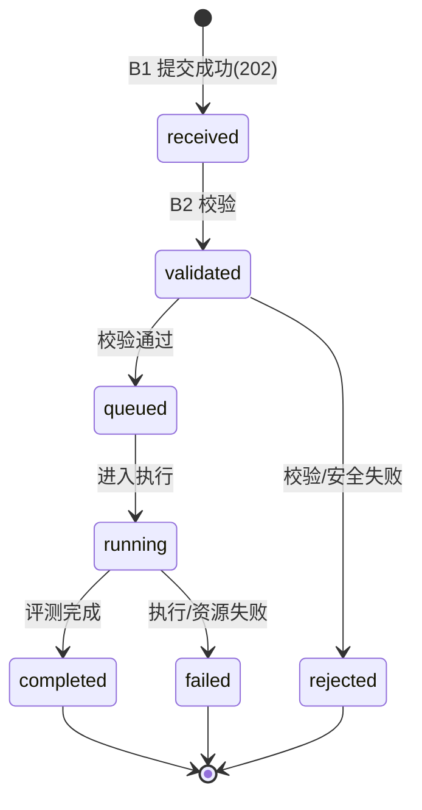
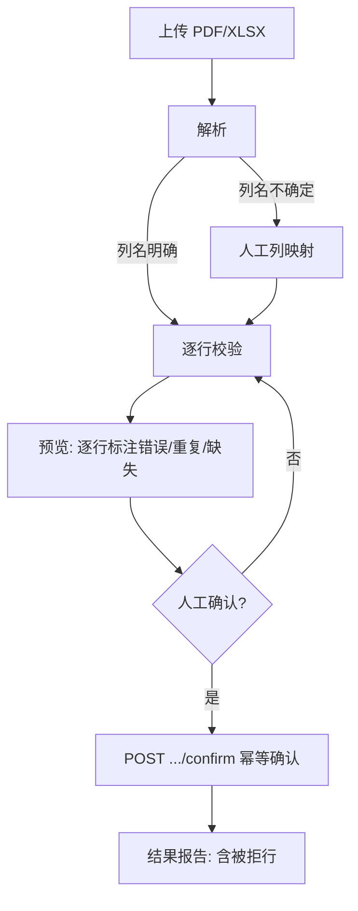
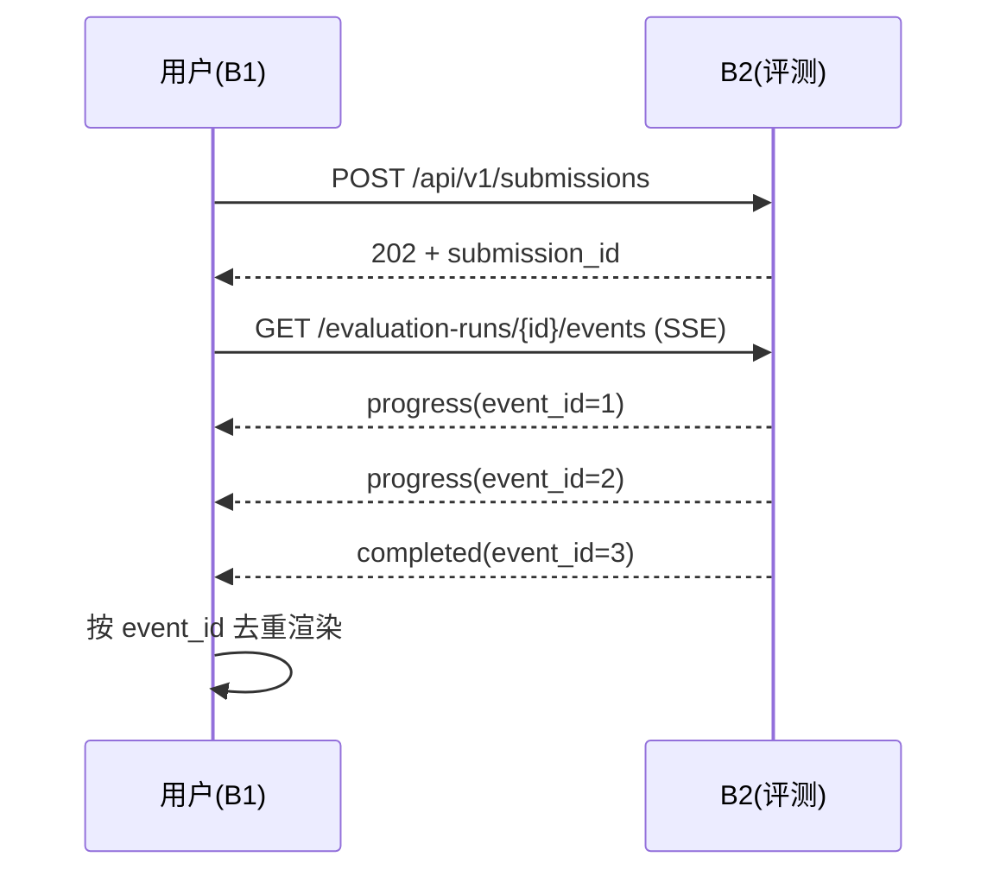

# B1 关键模型：状态机与时序

本模块无权威数据模型（数据模型归 B4/B3/B2），但有三组**交互状态模型**必须在实现前冻结，且必须与 B2 契约的状态取值一致。

## 1. 提交状态机（与 B2 一致，B1 只展示）

状态取值以 `../../../MAIN/contracts` 与 rq-catalog 的 `received → validated → queued → running → completed | rejected | failed` 为准，B1 **不得**新增或改名状态。



- 触发者：状态迁移全部由 **B2** 触发；B1 只通过 SSE 被动同步。
- 失败迁移：`validated → rejected`（静态/安全/格式问题）与 `running → failed`（执行/资源问题）语义不同，B1 展示时必须区分，不得把二者混为"失败"。
- 硬约束：未完成状态（received/validated/queued/running）**不得**显示为 0 分（RQ-B-1-30-4）。

## 2. 名单导入流程（活动）



- 关键：确认前 **零写入**；确认幂等；被拒行出现在结果报告，不静默丢弃（RQ-B-1-10）。
- "无法解析"是**正常分支**，不是异常（`../../../MAIN/docs/workstreams/B1.md` WP-B1-A 风险）。

## 3. SSE 进度时序



- 去重键：`event_id`（或契约定义的序号）；断线重连后**从断点继续**，不重复展示历史进度（RQ-B-1-50-5）。
- B1 订阅语义：`module.yaml` 声明订阅 `autograder.v1.evaluation.progress`、`autograder.v1.evaluation.completed`；运行时经 B2 的 SSE 呈现（静态客户端不直接持有 NATS 订阅）。见 `../api/events.md`。

## 4. 草稿生命周期（仅浏览器本地）

```text
编辑中 ──(自动保存)──▶ 本地草稿(localStorage/IndexedDB)
本地草稿 ──(提交成功)──▶ 清除
本地草稿 ──(断线重开)──▶ 恢复编辑
```

- 草稿 **不等于** 已提交（RQ-B-1-50-4）；提交成功即清除本地草稿。
- 草稿不得包含、也不得依赖任何权威数据。

## 一致性要求

以上状态取值/时序必须与 B2 契约与 `evaluation-report.schema.json` 一致；任何不一致先走 `../../../MAIN/docs/contracts/change-protocol.md`，不得在 B1 自建平行结构。

## 实现落点（与本文模型一一对应）

| 模型 | 实现文件 | 对应测试 |
|---|---|---|
| 1 提交状态机（展示） | `src/features/submission/ProgressPanel.tsx`（终态三态分开展示，未完成不显示 0 分） | `src/features/submission/SubmitPage.test.tsx` |
| 2 名单导入流程 | `src/features/roster-import/RosterImportPage.tsx` + `mapping.ts`（阶段判定直接取 `RosterImportPreview.status`） | `RosterImportPage.test.tsx`、`mapping.test.ts` |
| 3 SSE 进度时序 | `src/features/submission/progress.ts`（`sequence`/事件 id 去重、终态后丢弃）+ `useEvaluationStream.ts`（`Last-Event-ID` + 退避重连） | `progress.test.ts`、`SubmitPage.test.tsx` |
| 4 草稿生命周期 | `src/features/submission/draft.ts` | `draft.test.ts`、`SubmitPage.test.tsx` |

> 去重键的落地口径：SSE 的 `id:` 存在时按事件 id 去重，`sequence` 单调推进并丢弃回放的历史帧；
> 二者都在 `applyFrame()` 中实现，是纯函数，可独立验证（`progress.test.ts`）。
