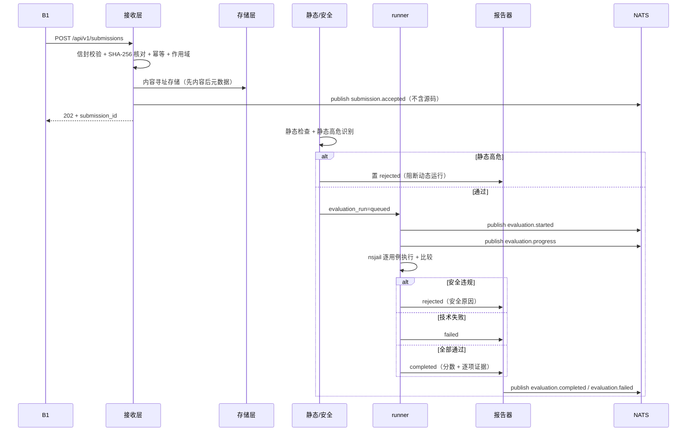

# B2 状态机与关键时序

## 1. 提交状态机（MAIN 锁定，不可改）

状态取值集合由 MAIN 锁定（见 [../../../MAIN/docs/workstreams/B2.md](../../../MAIN/docs/workstreams/B2.md) 第 8 节）：

```text
received → validated → queued → running → completed | rejected | failed
```

| 状态 | 含义 | 触发者 | 失败迁移 |
|---|---|---|---|
| `received` | 请求已接收，尚未校验 | 接收层 | — |
| `validated` | 信封/摘要/作用域校验通过 | 接收层 | 校验失败 → `rejected`（不落库） |
| `queued` | 进入评测队列，`evaluation_run` 创建 | 静态检查通过后入队 | 入队失败 → `failed` |
| `running` | 动态执行中 | runner | — |
| `completed` | 全部用例完成，分数与报告已持久化 | runner→reporter | — |
| `rejected` | **安全原因**：静态高危阻断 / 执行期安全违规 | 安全判定 / runner | — |
| `failed` | **技术原因**：超时/资源超限/崩溃/依赖不可用 | runner / 基础设施 | — |

> 注意：`rejected` 有两条到达路径——**静态阶段**（`validated` 之后静态高危阻断，不进入 `running`，对应 RQ-B-2-40 验收 #4）与**执行阶段**（`running` 中沙箱安全违规，对应 RQ-B-2-70）。`failed` 仅由技术性原因触发。二者**必须**区分，不得把安全拒绝记为技术失败。

## 2. 评测运行状态机（内部，**已实现**）

`evaluation_run` 是 `submission` 通过校验并进入队列后创建的运行实体（`evaluation_run_id` 生成时机见 [../../../MAIN/docs/api/identifiers.md](../../../MAIN/docs/api/identifiers.md)）。

```text
queued → running → completed | rejected | failed
```

- `evaluation_run.status` 与 `submission.status` 在 `queued` 之后同步，**但这条 1:1 只对"首次评测周期"成立**：
  提交级状态无法表达"第二次及以后"的运行（同一提交重跑时，`submission.status` 已是终态，不是合法迁移起点），
  实现自己的 docstring 即如此限定（`src/autograder_b2/evaluation/store.py` 的终态同步函数："本函数让提交状态
  反映**首次**评测周期…第二次及以后的运行无法在提交级表达"）。**更正（2026-09-16）**：本行此前是无条件的
  "1:1 同步"，与实现不符；该偏差由组级复核记为残余项 R1（见
  [../phases/active/reviews/REVIEW_L1_orchestration_RECHECK.md](../phases/active/reviews/REVIEW_L1_orchestration_RECHECK.md) 第 103-116 行），
  并已登记为 [../phases/active/phase-01-implementation.md](../phases/active/phase-01-implementation.md) 缺口第 40 条
  （重复评测的提交级语义需 MAIN 定契约，B2 不擅自改）。运行侧的完整历史仍逐条落库在
  `b2.evaluation_run_state_transitions`，不因提交级不可表达而丢失。
- 每次迁移都写状态迁移史（时间戳 + 迁移 + 失败错误类别），满足 RQ-B-2-60。
- 状态常量必须与代码中的常量定义一致（实现时从单一常量源导出，避免字符串漂移）。
- **实现状态（2026-09-16 更正）**：本状态机**已实现并落库**——常量在 `src/autograder_b2/domain/states.py`，
  迁移史在 `b2.evaluation_run_state_transitions`（由迁移 **`20260915_0006`** 创建该表；`20260915_0005`
  建的是提交侧 `submission_state_transitions`），终态与 `terminal_reason` 的配对
  由迁移 `20260915_0009` 的两条 CHECK 强制（`rejected` 只带 `static_blocked`/`security_blocked`；
  `failed` 只带 `infrastructure_error`/`internal_error`）。证据：
  `tests/test_evaluation_pipeline.py::test_terminal_state_and_reason_must_be_a_contract_pair`、
  `::test_run_transition_history_is_contiguous_and_reason_redacted`、
  `::test_illegal_run_transition_is_rejected_before_write`。**更正**：本小节标题此前写"待实现"，与同文件
  第 1 节及实现相矛盾，已按实现刷新。

## 3. 关键时序（提交 → 静态 → 安全 → 动态 → 报告）



关键不变量（见 [../../../MAIN/docs/architecture/models.md](../../../MAIN/docs/architecture/models.md)）：
- 已发布题目版本与 evaluation package 不可变。
- B2 是分数与逐项执行证据的唯一 owner。
- schema 间无 FK；跨模块引用只传 UUID。

## 4. 用例证据模型（CaseEvidence）

每条动态用例产出一条证据，供报告逐分追溯（RQ-B-2-50、2-80）：

| 字段意图 | 说明 |
|---|---|
| 用例标识 | `case_id`（内部，不出现在公开 DTO） |
| 输入摘要 | 输入/参数摘要（不含源码全文） |
| 实际输出摘要 | 截断后的 stdout/stderr/退出码/文件差异摘要 |
| 期望输出摘要 | 期望摘要 |
| 判定 | 通过/失败 |
| 失败类别 | 超时 / 崩溃 / 输出不符 / 资源超限（枚举） |
| 证据摘要 | 本条证据的 SHA-256（可重放比对） |

## 5. 绑定摘要（可重放性基础）

每一次评测绑定五项摘要并写入评测记录（权威定义见 [../../../MAIN/docs/api/identifiers.md](../../../MAIN/docs/api/identifiers.md) 第 4 节）：提交摘要、题目版本绑定、测试包摘要、runner 策略摘要、执行环境摘要。**五项摘要全部相同 ⇒ 同一分数与同一逐项证据**，这是可重放测试断言与申诉复核的依据。

## 6. 数据生命周期

```text
SubmissionEnvelope ─▶ submission（received→…） ─▶ evaluation_run ─▶ evaluation_result
        │                                                │
        └─ artifact（内容寻址，多提交共享）              ├─ security_finding（0..n）
                                                         └─ case evidence ─▶ evaluation-report
```

- `artifact` 可被多个提交共享；`email_checkpoint` 独立于提交生命周期（IMAP 幂等）。
- 保留/清理策略见 [../database/schema.md](../database/schema.md)。
