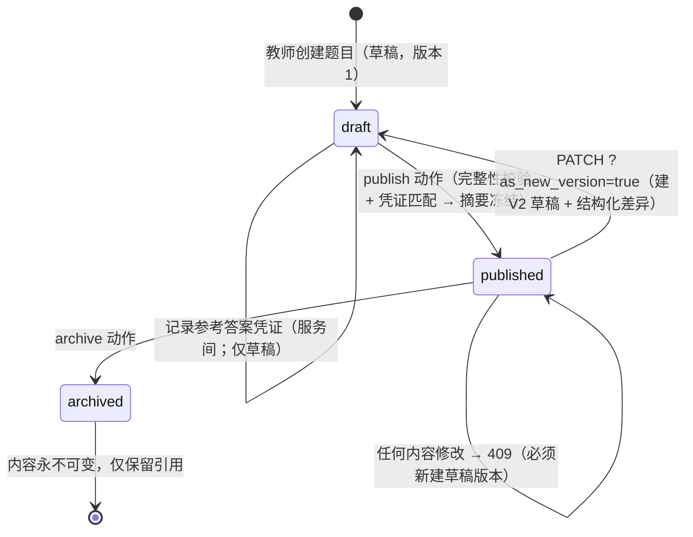
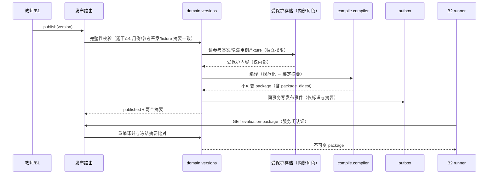
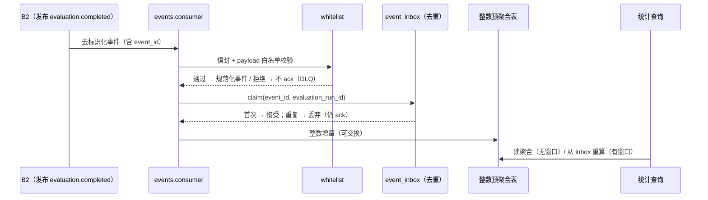

# B3 模型与状态机（Models）

> 状态：以下状态机 / 时序**已在代码中实现**，常量与图中一致；实现位置与测试见每节末尾。字段细节一律以 `MAIN/contracts/**` 与 `alembic/versions/**` 为准，本文件不抄字段表。

## 1. 题目版本生命周期

| 状态 | 含义 | 可编辑 | 可入 assignment | 可编译 package | 可删除 |
|---|---|---|---|---|---|
| `draft`（草稿） | 未发布，内容可自由改；`content_digest` 随内容重算 | 是 | 否 | 否（内部端点 → `409`） | 是（级联删受保护内容与凭证） |
| `published`（已发布/不可变） | 显式发布，内容不可变 | 否（改→`409`→新版本） | 是 | 是 | 否（触发器拒绝，只能归档） |
| `archived`（归档） | 保留历史引用，不再分配给新作业 | 否 | 否 | 是（历史评测需要可重放） | 否 |

- **触发者**：`draft→published` 由教师显式 `publish`；`published→archived` 由教师动作；`published→draft` 只通过"新建版本"发生（旧版本不动）。
- **失败迁移**：完整性校验失败 → `422`；**缺凭证或凭证摘要不匹配** → 分别 `422` / `409`（下表）；两种失败都不产生事件、不生成 package，版本停留 `draft`。
- **不可变判据**：`content_digest`（题干 + 参考答案 + adapter + 用例 + fixture 摘要 + 限制项的规范化摘要）与 `package_digest` 一经发布即固定。任何字段变更都必须产生新 `question_version_id`。
- **凭证是发布的前置条件**：`draft` 阶段的 `content_digest` 可被外部验证器读到并据此上报凭证；`publish` 只认与**自己重算值**一致的凭证。因此"改内容使凭证失效"不需要任何逻辑——摘要变了就不匹配了。

  | 情形 | 响应 | `type` 后缀 |
  |---|---|---|
  | 无匹配凭证 | `422` | `reference-attestation-missing`（detail 给出补救动作） |
  | 上报摘要与服务端重算不符 | `409` | `attestation-mismatch` |
  | 上报用例数与版本实际用例数不符 | `409` | `attestation-mismatch` |
  | 版本非草稿 | `409` | `invalid-state-transition` |

- **双重保证**：应用层抛 `ImmutableVersionConflict`（`409`）；PostgreSQL 触发器 `b3.tg_question_versions_guard` 与 `b3.tg_protected_content_guard` 以 SQLSTATE `23001` 拒绝绕过应用层的写操作（API 异常处理器把 `23001` 映射为 `409`）。
- **修订闭环**：`published → draft` 时计算并落库结构化差异（`revision_diff`）与修订理由（`revision_note`）。差异只含计数、长度、摘要与存在性——**不含题干正文、参考答案或期望输出**，键集合**恰好**是契约 `RevisionDiff` 的 11 个键（落库形状 = 公开形状，测试直接读契约文件断言）。理由优先取作者手写的值，没有才按差异派生。首版两个字段均为 `null`（"未比较"，不是"比较后相同"）。读写出口见 [../api/contract.md](../api/contract.md) 的 `CHG-0013` 一节。
- **实现**：`domain/versions.py`、`domain/questions.py`、`domain/attestations.py`、`domain/version_content.py`、`domain/revisions.py`、`alembic/versions/20260915_0002_*.py`、`alembic/versions/20260915_0003_*.py`。
- **测试**：`tests/test_versions.py`（TC-VER-01~07）。

## 2. package 编译流程

- package 是**内容寻址不可变产物**：同一 `question_version` 的同一内容编译结果摘要恒定（`created_at` 必须等于版本 `published_at`，因此时间维度也不引入漂移）。
- 绑定摘要：`question_version_id` + `content_digest` + `package_digest`（见 `../../../MAIN/docs/api/identifiers.md` §4）。
- 三型 adapter 共用同一 package 结构与统一校验入口，仅 `adapter` 段语义不同（ADR-0002 / ADR-0005）。
- **重编译校验**：`GET evaluation-package` 不是读缓存，而是按冻结内容重编译再比对摘要——发布后若受保护内容被改动（即使绕过应用层），响应为 `409` 而不是把被改动的用例发出去。
- **实现**：`domain/versions.py`、`domain/packages.py`、`compile/*`。
- **测试**：`tests/test_adapters.py`、`tests/test_versions.py`。

## 3. 统计聚合时序

- **去重键**：`event_id`（主）、`evaluation_run_id`（辅）。at-least-once 投递下重复事件不重复计数；重复投递**要 ack**（否则会无限重投）。
- **可重放**：清空聚合表 → 从 `event_inbox` 按 `occurred_at` 重放 → 得到相同统计值（全部为整数计数，无浮点累加器，故顺序无关）。
- **隐私**：消费端只接受白名单字段；`student_id` 等身份字段在禁止清单中，出现即拒收并在 DLQ 可见。
- **实现**：`events/consumer.py`、`events/whitelist.py`、`stats/*`；运维入口 `consumer_cli.py`。
- **测试**：`tests/test_statistics.py`（TC-STT-01~05）。

## 4. adapter manifest 模型

三种 adapter 共享**共同段** + 各自**专属段**；共同段与 `evaluation-package.schema.json` 对齐（字段细节以契约为准，此处只写语义）：

| adapter | 专属语义 | 校验要点 | 对应 RQ |
|---|---|---|---|
| `stdin` | 命令行参数数组（非 shell 字符串）+ 标准输入；期望 stdout/stderr 比较策略 + 退出码 | 必须有 args/stdin/expect_exit_code 之一；不得声明 callable；files 只允许 `input` | `RQ-B-3-40` |
| `file` | 输入 fixture 集合（含内容摘要）+ 期望产出文件（`mount=expected_output`，带摘要）+ 比较策略 | 至少一个 `input` fixture；声明摘要必须与存储内容一致；路径限工作区 | `RQ-B-3-50` |
| `callable` | 模块名 + 可调用对象名 + 参数序列化（JSON） | 点分标识符（拒路径/URL/`;`）；`arguments_json` 必须是合法 JSON；files 只允许 `input` | `RQ-B-3-60` |

- 共同语义：`language`（受限枚举 `python`/`bash`，与 B2 runner policy 同枚举，见 `RQ-B-0-10`）、`adapter.kind`、比较策略、`security_policy`（三个常量不可被题目作者关闭）。
- 校验统一入口：`compile/manifest.py: validate_adapter_manifest`——拒绝绝对路径、`..`、盘符、shell 字符串、工作区外加载、越界枚举、重复 fixture 声明。
- **实现**：`compile/manifest.py`、`compile/validation.py`、`compile/adapters.py`、`compile/registry.py`；冻结签名见 [../collaboration/frozen-interfaces.md](../collaboration/frozen-interfaces.md) §3。
