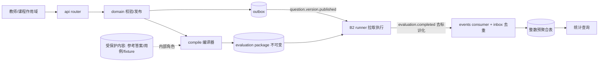

# B3 架构概览（Overview）

## 在系统中的位置

B3 是 MAIN composition host 装载的**题库与测试包插件**。它不独立对外提供进程（同步 API 由 host 装载），不执行评测。位置关系见根 [README.md](../../README.md) 的 ASCII 图。

- 上游：B4（身份 / 课程作用域 / JWT）、教师经 B1 的编辑内容、B2 的去标识化 `evaluation.completed` 事件。
- 下游：B1（公开题目 DTO、题干图片受控资源）、B2（`evaluation-package` 内部接口）、统计查询（B1 展示）。
- 交互方式：与 B1/B2 为 HTTP + 事件；与 B4 为 HTTP（作用域校验 + JWKS 本地验签）。**B3 从不导入 B1/B2/B4 的代码**，只经平台 SDK 与 `MAIN/contracts/**` 交互。
- 进程形态：同步 API 在 host 内；异步部分（统计消费 + outbox 投递）可同进程，也可由 `python -m autograder_b3.consumer_cli` 独立运行。

## 内部层次与依赖方向（与代码一致）

```text
┌──────────────────────────────────────────────────────────────┐
│ api/        router · serializers(白名单) · deps(鉴权/上下文)   │
│             pagination · app(Problem Details + 请求日志)       │
├──────────────────────────────────────────────────────────────┤
│ domain/     题目聚合 · 版本发布/归档 · 上传 · assignment ·      │
│             公开读 · 统计查询 · package 重编译校验 · outbox     │
├──────────────────────────────────────────────────────────────┤
│ compile/    canonical · policy · validation · registry ·      │
│             三型 adapter · manifest(统一校验入口) · compiler   │
│ stats/      buckets · aggregator(整数累加) · service(重放/窗口)│
│ events/     envelope · whitelist(去标识化白名单) · consumer    │
├──────────────────────────────────────────────────────────────┤
│ infra/      db(双引擎/双角色) · models(b3) · repositories ·    │
│              storage · publisher(NATS/内存)                    │
└──────────────────────────────────────────────────────────────┘
```

依赖方向自上而下：`api → domain → {compile, stats, events} → infra`。**禁止反向依赖**（infra 不得 import api/domain）。`compile`、`stats`、`events` 是 domain 的下游能力，彼此不互相依赖（`events` 只依赖 `stats` 的聚合函数，方向单向）。

横切模块：`auth.py`（RS256/JWKS 验签 + 作用域策略）、`errors.py`（RFC 9457 分类）、`logging.py`（脱敏 JSON 日志）——三者不依赖任何业务层。

## 主要数据流



1. **题目编辑流**：教师提交（携带参考答案与用例）→ 作用域校验 → 落 `draft` 版本（**内部角色**事务）→ 显式 `publish` → 完整性校验 + 计算 `content_digest` → 编译 package 得 `package_digest` → 同事务写 outbox → drainer 发 `question.version.published`。
2. **package 读取流**：B2 以服务间凭据请求 → 领域层用**内部角色**重编译 → 与冻结的 `package_digest` 比对（不符即 `409`，可发现"发布后受保护内容被改动"）→ 返回 package。
3. **统计流**：B2 发去标识化 `evaluation.completed` → 白名单校验 → `event_inbox` 去重（`event_id` 主键 / `evaluation_run_id` 唯一）→ 整数增量入预聚合表 → 查询接口读聚合（带时间窗时从 inbox 重算）。越界字段拒收且**不 ack**。

## 与其它模块的契约关系

- 契约权威：`../../../MAIN/contracts/`（OpenAPI / AsyncAPI / JSON Schema）；版本与摘要见根 `contracts.lock`。
- 我提供的端点：见 [../api/contract.md](../api/contract.md)（含 3 个"未成文但已实现"的操作与 `CHG-B3-0002`，
  以及 `CHG-0013` 落地的三个质量出口）。
- 我发布的事件：`autograder.v1.question.version.published`；订阅的事件：`autograder.v1.evaluation.completed`。

## 已知缺口（如实）

1. **SDK 事件方向缺口**：`B3Module.descriptor.events` 是扁平元组，承载 publishes ∪ subscribes（`question.version.published` 与 `evaluation.completed` 都在其中），但**不区分方向**；`module.yaml` 才是带方向的权威。宿主目前无法校验事件方向（`MAIN/docs/adr/ADR-0003` 遗留风险）。B3 的处理：以 `module.yaml` 为准，**不发明第二套约定**（那会变成兼容层）；修复需 SDK 破坏性变更，走契约变更规程。
2. **契约缺口**（不改 `MAIN/contracts/**`，只上报）：
   - `CHG-B3-0001`：file adapter 的"文本差异"比较粒度在冻结 schema 中不可表达（已实现存在性 + 内容摘要）。
   - `CHG-B3-0002`：图片上传/读取、fixture 上传、创建题目的 `course_id` 参数未成文（已实现且落在既有前缀内）。
   - `CHG-B3-0003`：事件禁止 `student_id` 且 `QuestionStatistics` 无对应字段，故"独立作答人数"与平均分不计算。该 CHG 同时请求确认 `is_pass` 字段名——**已裁决**：`is_pass` 是权威名，`MAIN/contracts/examples/event-evaluation-completed.json` 亦已含 `score`/`max_score`/`is_pass`。
   - **`CHG-0013` 已裁决并落地**（[Phase 04](../phases/active/phase-04-quality-surfaces.md)）：修订理由/结构化差异（`revision_note`/`revision_diff`）、比较策略诊断端点、标签检索都已成为契约路径，不再是缺口。同轮发现的一处**实现偏离契约**（`Severity` 多出一个契约未声明的 `note`）已由 B3 改实现对齐；曾误报为"契约笔误"，`CHG-0016` §5 已驳回该说法，见 [../README.md](../README.md) 已知限制。
   - **`CHG-0016` 已裁决 `PATCH /api/v1/questions/{id}` 的响应体**：契约原先声明 `QuestionVersionPublic`，而实现返回 `QuestionPublic`。MAIN 判定**契约是错的一侧**（`QuestionDraftInput` 能改 `title`/`tags`，而 `QuestionVersionPublic` 没有这两个字段且 `additionalProperties: false`），契约改为 `QuestionPublic`（0.11.0）。**B3 无需改代码**——实现本来就是对的。
3. **跨模块联调未做**：B2 runner 实际执行、NATS durable consumer/DLQ 真实行为、B4 真实 JWKS 端点（见 [../testing/strategy.md](../testing/strategy.md) 未覆盖清单）。`CHG-0013` 的三个新出口同样只做过 HTTP 契约级验证，**未经真实宿主端到端调用**。
4. **性能只测了一半**：10 万事件量级**已实测**（[Phase 03](../phases/active/phase-03-quality-attestation-and-bounded-statistics.md)）：预聚合路径 0.044 s / 0.66 MiB，窗口路径分页后峰值内存 5.10 MiB（相对无界语句 256.59 MiB，50.3×），**但窗口路径耗时 23.8 s，未达标**。结构性保障（预聚合 + 复合索引 + keyset 分页）已就位，缺的是把窗口求和下推到 SQL 或按时间桶预聚合。
5. ~~**响应体与契约不符 1 处**~~ → **已裁决并关闭（`CHG-0016`，契约 0.11.0）**：见上面缺口 2 的最后一条；契约改为 `QuestionPublic`，B3 实现无需改动。
