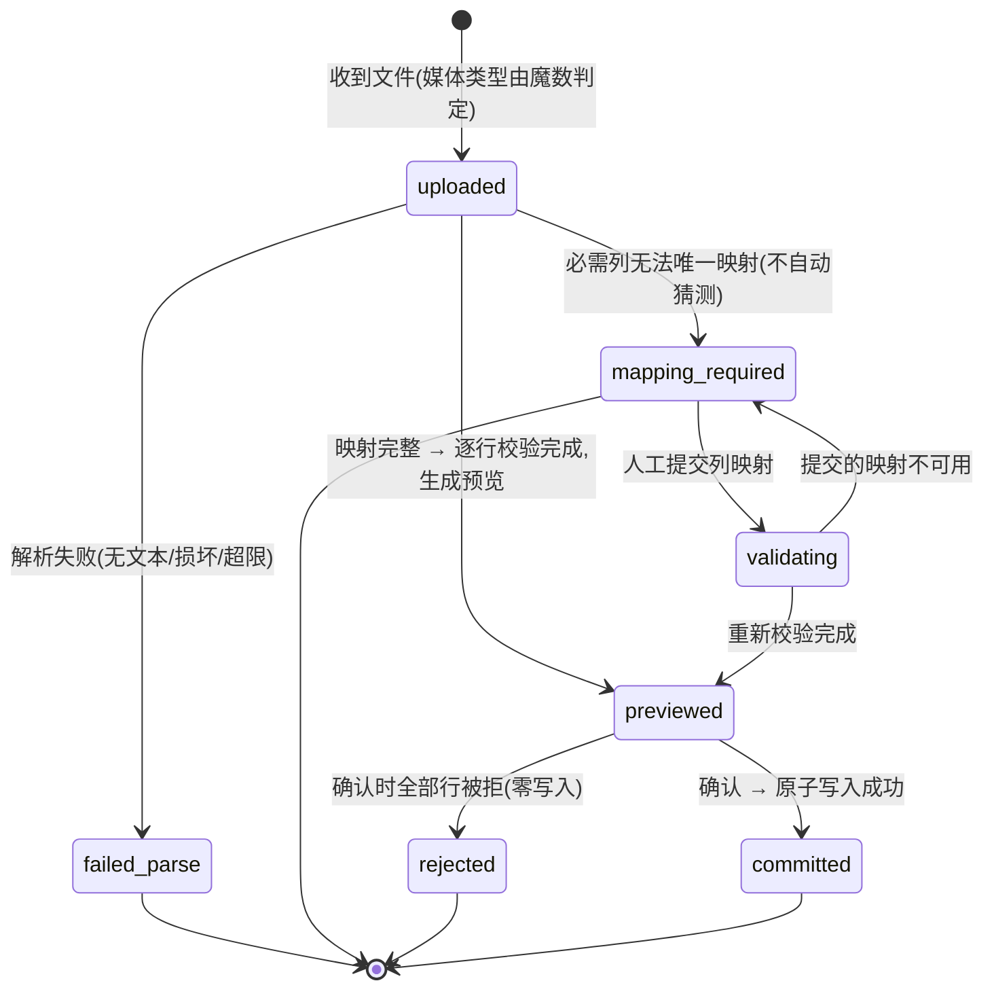
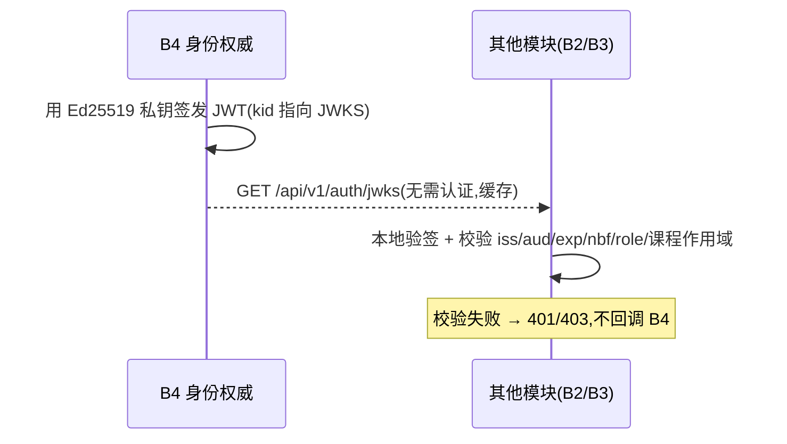

# B4 状态机与时序

> 状态取值以 `../../MAIN/contracts/openapi/b4.yaml` 的 `RosterImportPreview.status` 枚举为**唯一权威**
> （`uploaded` / `parsed` / `mapping_required` / `validating` / `previewed` / `committed` / `rejected` /
> `failed_parse`）。本文件此前使用过一套自造状态名，已按契约统一——**不维护第二套状态词**。
>
> 实现见 `src/autograder_b4/roster/service.py`；实测见 `tests/test_roster_import.py`。

## 1. 名单导入状态机



- **触发者**：`uploaded`/解析/校验由系统；`mapping_required → validating` 由人工提交映射；
  `previewed → committed` 由教师确认。
- **每个持久化状态都是进程可以真正被打断的状态**：`uploaded` 在解析前提交（解析崩溃仍留有可审记录），
  `validating` 在重新校验前提交。`parsed` 存在于契约枚举中但本实现不停留（映射与校验在同一次请求内
  完成），不使用它做终态。
- **关键不变量**（均有测试）：
  1. 确认前 `b4.enrollments` **零写入**——解析结果只落在 `b4.roster_import_rows`
     （`test_xlsx_roster_parses_and_previews_without_writing`、`test_staged_rows_are_kept_separate_from_enrollments`）。
  2. 无法唯一映射 → `mapping_required`，**不自动猜测**：歧义字段不出现在 `proposed_mapping`
     （`test_ambiguous_columns_stop_for_a_human_decision`）。
  3. 被拒行**必须出现在** `rejected_rows`，带行号与原因，不静默丢弃
     （`test_rejected_rows_are_reported_with_a_reason`）。
  4. `previewed → committed` **幂等**：重复确认不写第二次，返回同一结果
     （`test_confirmation_is_idempotent`）。
  5. `committed` 与事件同事务：回滚则事件不存在
     （`test_the_event_is_queued_in_the_same_transaction_as_the_rows`）。
  6. 全部行被拒 → `rejected` 终态 + 审计**先提交再报错**（`test_a_fully_rejected_roster_commits_nothing_and_is_terminal`）。
- **行号语义**：XLSX 用电子表格真实行号（表头是第 1 行）；PDF 用表内行号（表头行是第 1 行）。

## 2. 登录 / 刷新时序

```mermaid
sequenceDiagram
    participant C as B1 客户端
    participant B4 as B4 认证
    C->>B4: POST /api/v1/auth/session (用户名+密码)
    B4->>B4: 限流账本检查(失败次数/窗口)
    alt 已限流
        B4-->>C: 429(记账与审计先提交,再报错)
    else 继续
        B4->>B4: Argon2id 比对(用户不存在也做一次等价哈希)
        alt 失败
            B4-->>C: 401(与"用户不存在"完全同形;记账先提交)
        else 成功
            B4->>B4: 签发短期 JWT(Ed25519) + 创建 session(刷新凭据句柄)
            B4-->>C: 200: 响应体=一次性访问令牌; Set-Cookie=刷新凭据(HttpOnly/Secure/SameSite=Strict)
        end
    end
    C->>B4: POST /api/v1/auth/session/refresh (仅带 cookie)
    B4->>B4: 校验摘要 → 轮换(旧行 rotated_at + replaced_by) → 新 JWT + 新 cookie
    alt 旧凭据被再次出示
        B4->>B4: 判定为重放 → 撤销整个 family → 审计(先提交,再 401)
        B4-->>C: 401
    else 正常
        B4-->>C: 200 + 新令牌 + Set-Cookie
    end
```

- 刷新凭据**只**在 cookie 中，不进响应体、不进日志；服务端只存 SHA-256 摘要。
- 登录失败与限流路径都在**事务提交之后**才返回错误——否则记账与审计会随错误一起回滚。

## 3. 令牌签发与本地校验时序



- 其他模块**本地验签，不回**调 B4（信任边界核心）。
- 令牌是短期凭据（默认 900s）；角色与作用域**另在每次请求时从库中重读**，因此撤权立即生效，而非等到
  令牌过期。

## 4. 模块装载与注册表时序

```mermaid
sequenceDiagram
    participant H as MAIN host
    participant R as B4 注册表
    H->>H: 按 entry point 装载各插件(含 B4)
    H->>R: 调用 B4.router(context) —— 此时各模块已完成 import
    R->>R: 解析 entry point 为真实 descriptor
    R->>R: 三方一致性校验(module.yaml ↔ descriptor ↔ 契约摘要)
    alt 不一致
        R-->>H: 抛 RegistryError → host 启动失败(指明模块与字段)
    else 一致
        R->>R: 聚合健康 + 能力/路由/事件清单
        R-->>H: GET /api/v1/modules(管理员全量); GET /api/v1/modules/{m}/health(公开仅存活)
    end
```

- 设计期契约归 MAIN、运行期注册表归 B4（见 `../../MAIN/docs/adr/ADR-0003-api-authority-and-runtime-registry.md`）。
- 校验点：模块被装载但无 `module.yaml`、descriptor 与 manifest 字段不一致、路由前缀重复、
  已装载模块的 capability 无人提供、`contracts.lock` 摘要与实时契约树不符——六类漂移**全部**导致启动失败。
- 已知缺口：`descriptor.events` 扁平元组无法表达 publishes/subscribes 方向，注册表据此只能做集合包含
  校验，方向以 `module.yaml` 为准（ADR-0003 遗留风险）。
