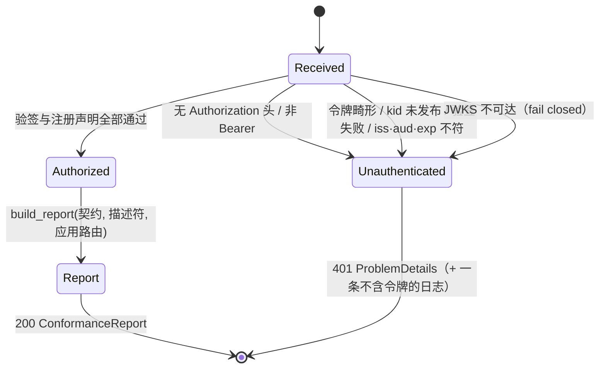
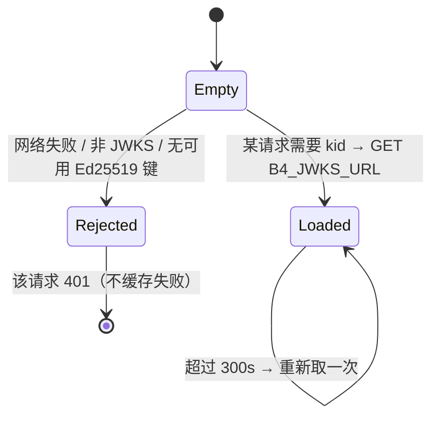

# 模型：请求生命周期、缓存与判定表

本模块没有数据库状态机。它的"模型"是三个：一次请求的生命周期、验签公钥缓存的寿命、
以及比对判定表的真假条件。

## 1. 请求生命周期



**失败迁移是终态**：B5 没有重试、没有降级、没有"先放行后校验"。`401` 的四种来源在
契约上同形（都是 `Unauthorized`），只有 `detail` 与日志区分原因。

## 2. JWKS 缓存生命周期



要点：

- 缓存**按 URL 分键**：换配置不会被上一家 issuer 的键回答。
- 键集为空或全部不可解析 → 视为失败（fail closed），不会退化成"没有键就没有校验"。
- 不缓存失败结果：B4 短暂不可用不会把 B5 钉死 300 秒。
- 缓存在进程内、加锁；重启即失效（只读模块，不需要跨进程一致）。

## 3. 三视图判定表

记 `P` = 契约声明的路径（视图 1），`M` = 已装载模块 descriptor 声明的前缀（视图 3），
`H` = 宿主应用服务、但无任何模块声明覆盖的路由（视图 2）。

| P 被某个 M 覆盖 | P 被某个 H 覆盖 | 结果 |
|---|---|---|
| 是 | — | 无差异（模块在服务它） |
| 否 | 是 | 无差异：宿主自己服务的平台级路由**有意在契约之外**（ADR-0007、`/health/*`） |
| 否 | 否 | `contract_path_unserved`，detail = `<契约文件> declares <路径>, which no loaded module's declared route covers` |

| 某个 M 前缀下有 P | 结果 |
|---|---|
| 是 | 无差异 |
| 否 | `descriptor_route_undeclared`，detail = `<模块> declares route <前缀>, but no path in MAIN/contracts/openapi declares it` |

`consistent = (differences == [])`。

**前缀 vs 全路径**：`P` 是完整路径（`/api/v1/auth/session`），`M` 是前缀（`/api/v1/auth`）。
判定关系是"包含"而不是"相等"——MAIN 的静态门禁曾经因为按字面比较而报了 27 处假不一致，
B5 与它共用同一个语义（`under()`），这是刻意的：两个检查器对同一个问题必须给出同一个答案。

## 4. 装载顺序模型（B5 为什么排在最后）

```text
provided = {host}
  → 就绪者按名字排序装载，装载后并入其 provides
B4(host) → {…, b4-auth, b4-course}
B3(host, b4-course) → {…, b3-questions}
B2(host, b4-auth, b3-questions) → {…, b2-submissions}
B5(host, b4-auth, b3-questions, b2-submissions) → 最后
```

`B5` 的四个 `requires` 全部来自既有模块的**真实能力名**（B4 的 `b4-auth`、B3 的 `b3-questions`、
B2 的 `b2-submissions`，加基础能力 `host`）。这不是为了"让 DAG 有东西可排"而编的依赖：
报告描述的是**这个组合**，缺任何一个业务模块，契约里属于它的路径都会被报成无人服务——
那是错的报告，不是更小的报告。
