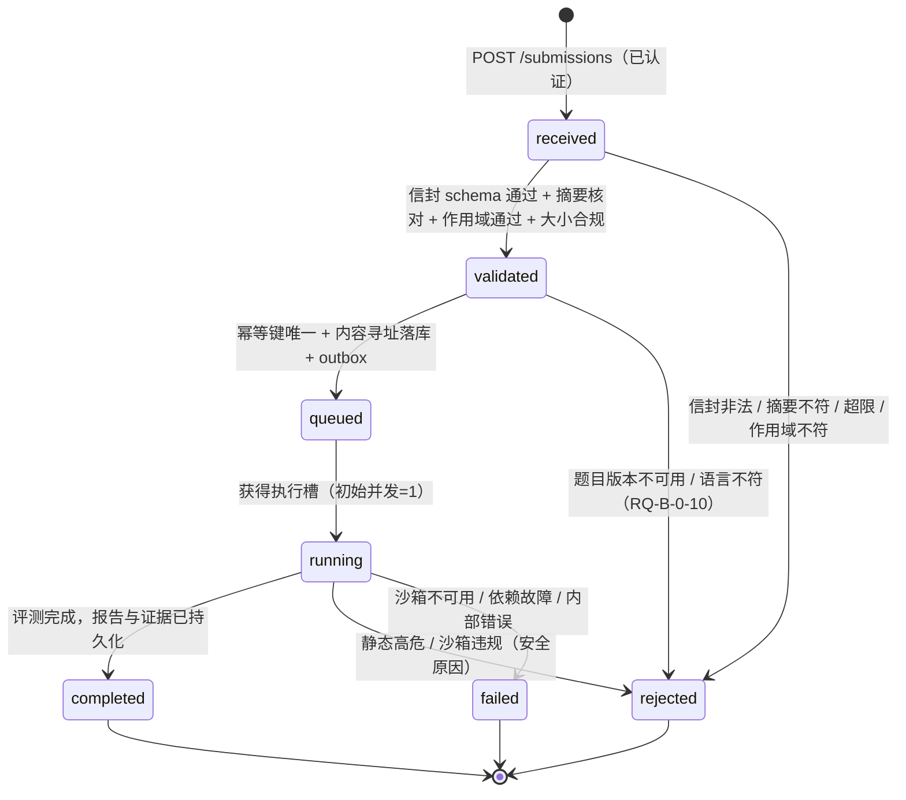
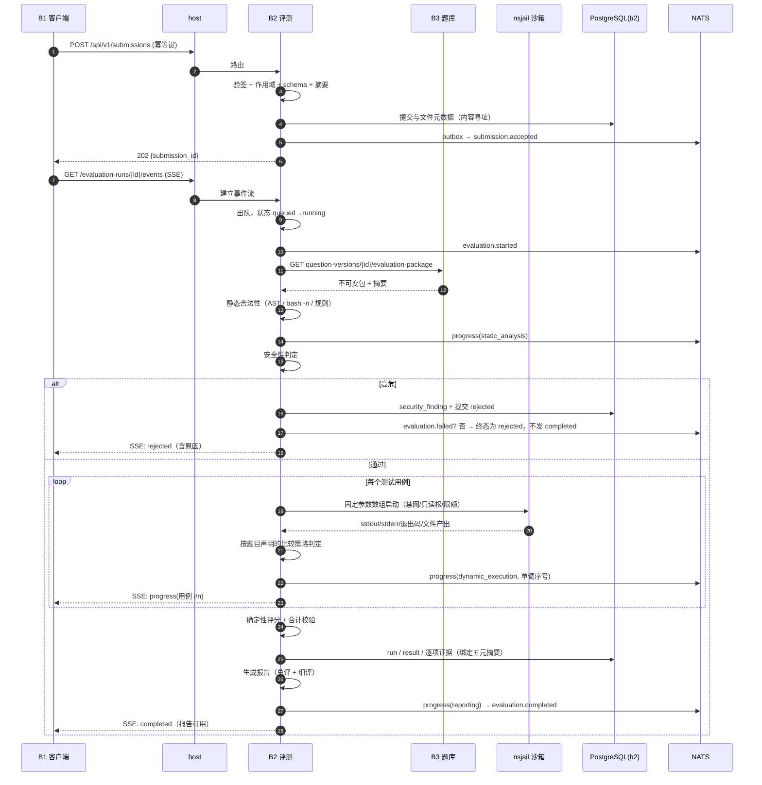
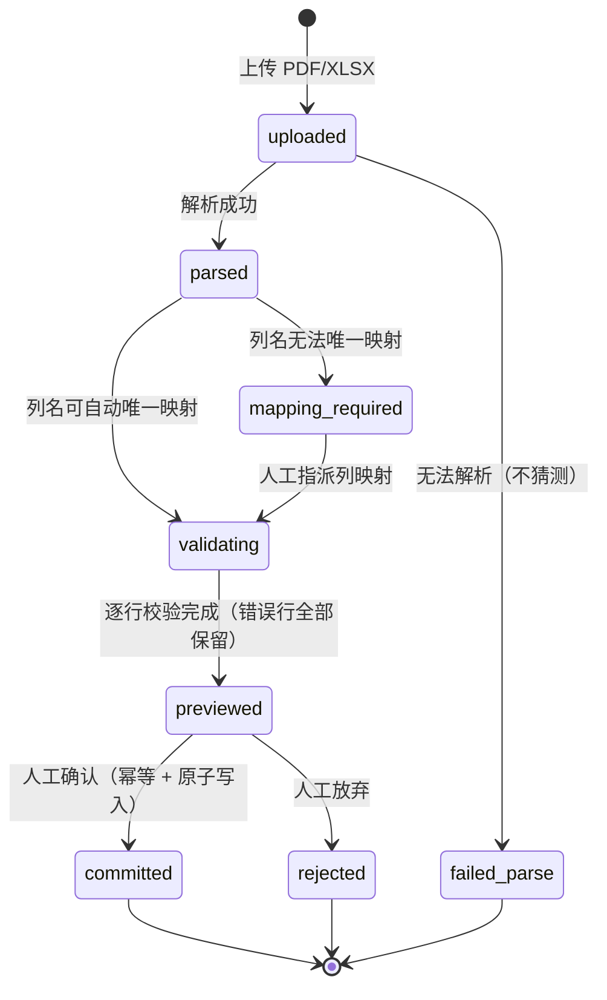
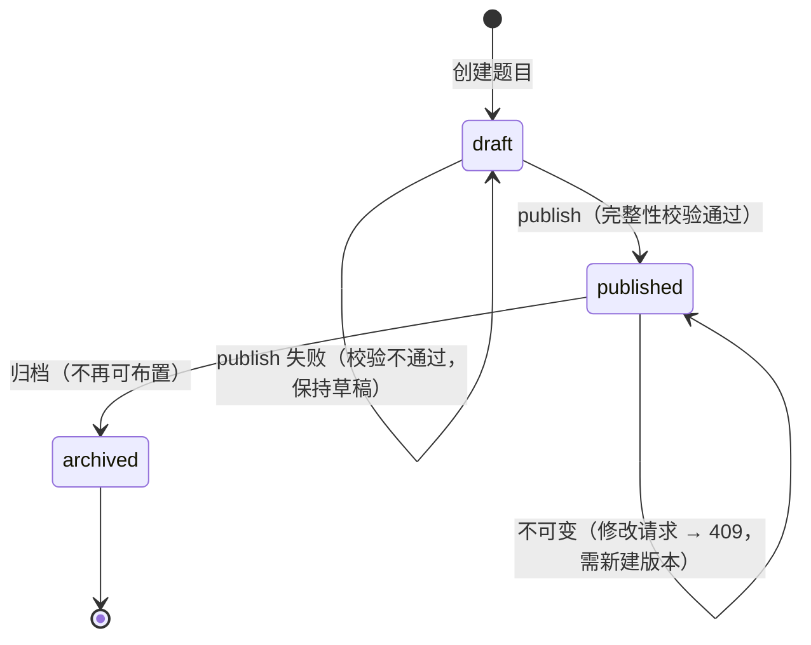

# 建模：状态机、时序、数据流与实体关系

本文是跨模块**行为模型**的权威位置。状态取值、事件名、迁移触发者必须与代码常量、`MAIN/contracts/` 保持一致；出现不一致时以契约为准并立即修正本文。

图使用 Mermaid（优先）与 ASCII（简单结构）。所有状态名使用 `snake_case`，与 API/事件中的字面量一致。

---

## 1. 提交（submission）状态机



| 状态 | 语义 | 终态 | 允许的下一状态 |
|---|---|---|---|
| `received` | 已接收，未校验 | 否 | `validated` / `rejected` |
| `validated` | 校验全部通过 | 否 | `queued` / `rejected` |
| `queued` | 已入队等资源 | 否 | `running` |
| `running` | 正在评测 | 否 | `completed` / `rejected` / `failed` |
| `completed` | 完成，报告可用 | **是** | — |
| `rejected` | **被拒**：非法或安全 | **是** | — |
| `failed` | **技术失败** | **是** | — |

### 语义约束（必须由测试断言）

0. **允许的迁移是穷举的**，机器可读版本在 `MAIN/contracts/openapi/b2.yaml` 的 `SubmissionTransitions`：

   | 来源 | 允许到达 |
   |---|---|
   | `received` | `validated`、`rejected` |
   | `validated` | `queued`、`rejected` |
   | `queued` | `running` |
   | `running` | `completed`、`rejected`、`failed` |
   | 终态（`completed`/`rejected`/`failed`） | **无** |

   **`rejected` 可从 `received`、`validated`、`running` 三处到达，这是刻意设计**：信封非法、语言不符、静态高危都必须在**不进入沙箱**的情况下被拒。因此**静态检查在 `queued` 之前执行**，"跑完发现失败"**不是**拒绝的替代品。`failed` 只能从 `running` 到达，因为技术失败以"执行被尝试过"为前提。

1. **`rejected` ≠ `failed` ≠ 低分**。三者语义不同，不得互相替代：
   - `rejected`：**你的提交有问题**（非法信封、语言不符、高危代码、沙箱违规）；
   - `failed`：**系统有问题**（依赖故障、沙箱不可用），**不算学生的问题**；
   - `completed` + 低分：**代码没通过测试**。
2. 终态不再产生新事件、不再迁移。
3. 每次迁移写入 `evaluation_run` 的迁移历史（时间、来源状态、目标状态、触发者、原因摘要）。
4. 静态高危**必须**阻断动态执行（`received→validated→rejected` 不经过 `running`）。**不允许**先跑再判。
5. 出现 `running` 但既有 `rejected`（安全）又有测试失败时，状态取**更严重的语义**：`rejected`。

---

## 2. 评测运行（evaluation run）进度模型

状态：`started → (progress)* → completed | failed`；`rejected` 路径由提交状态机承载。



### 进度事件约束

1. **单调递增序号**（`sequence`），供前端排序与去重（断线重连后不重复展示历史进度）。
2. 阶段可跳过（如静态高危时跳过 `dynamic_execution`）。
3. `evaluation.completed` **只在报告与证据已持久化之后**发出——不允许"事件先到、报告查不到"。
4. SSE 是**会话级**推送；`evaluation.*` 事件是**系统级**广播，二者内容可以不同（前者可含更多 UI 细节，后者必须去标识化）。

---

## 3. 名单导入状态机



| 不变量 | 说明 |
|---|---|
| 预览阶段**零写入** | `previewed` 之前数据库中不存在任何名单数据 |
| 不确定即报错 | 解析或映射不确定时进入 `mapping_required` / `failed_parse`，**绝不自动猜测** |
| 不静默丢行 | 校验失败的行必须出现在结果报告中（含行号与原因） |
| 确认幂等 | 重复确认不产生重复写入 |
| 确认原子 | 全部行成功或全部不写入（部分成功视为失败） |
| 从不动猜测数据 | 人工映射结果被记录，可回溯"是谁把哪一列映射成了学号" |

---

## 4. 题目版本生命周期



**完整性校验（publish 前置条件）**

1. 题干非空且资源可访问；
2. 参考答案存在（对应语言）；
3. 至少一条测试用例；
4. adapter 声明合法（三型之一，参数结构合规）；
5. 比较策略已声明（不得留空由 runner 决定）。

**不可变性规则**

- `published` 后内容任何变更必须产生**新** `question_version_id`。
- 原地修改 → `409 Conflict`。
- 被历史评测引用 → 不可删除（`409`），只能 `archived`。
- 发布时计算**内容摘要**；评测绑定该摘要，因此改题不会污染历史成绩的可解释性。

---

## 5. 逻辑实体关系（跨 schema，仅用 UUID 引用）

```text
        ┌──────── b4 schema ────────┐
        │ user ──< enrollment >── section ──< course
        │   │                        │
        │   └──< session             └──< assignment_ref（仅存 UUID，无 FK）
        │   └──< audit
        └───────────────────────────┘
                     ▲
                     │ user_id / course_id / section_id / enrollment_id
                     │ （UUID 值引用，**无跨 schema 外键**）
                     ▼
        ┌──────── b3 schema ────────┐
        │ question ──< question_version ──< test_suite ──< test_case
        │                     │                └──< fixture
        │                     └── reference_answer（受保护）
        │ assignment（course_id via UUID）
        │ question_stats（去标识化聚合）
        └───────────────────────────┘
                     ▲
                     │ question_version_id（评测绑定）
                     ▼
        ┌──────── b2 schema ────────┐
        │ submission ──< artifact
        │ evaluation_run ──< evaluation_result ──< case_evidence
        │                └──< security_finding
        │ email_checkpoint
        │ outbox / inbox（幂等与投递）
        └───────────────────────────┘
```

### 三个实体所有权不变量（ADR-0001）

1. **无跨 schema 外键**。跨模块引用一律用 UUID 值，由应用层校验存在性（而非数据库约束）。
2. **每个 schema 只有一个写者**（其 owner 模块的 role）。其他模块对该 schema **无任何权限**。
3. **物理表结构以各模块迁移为唯一事实源**。MAIN 的 `../database/ownership.md` 只记录所有权与 head，**不复制 DDL**。

> 代价：跨模块引用的**存在性**没有数据库级保证（可能出现悬空 UUID）。缓解：① 事件驱动的一致性（如题目归档事件让 B2 停止调度）；② 读取时对不存在引用返回明确错误而非 500；③ 定期一致性巡检（功能阶段定义）。

---

## 6. 评测证据模型（可解释性的载体）

```text
evaluation_result（一次评测的汇总）
├── 绑定摘要（五元）
│   ├── submission_digest        提交文件路径 + 各文件 SHA-256
│   ├── question_version_binding question_version_id + 版本内容摘要
│   ├── package_digest           evaluation package 规范化摘要
│   ├── runner_policy_digest     沙箱参数 + 解释器版本 + 比较策略
│   └── environment_digest       解释器/nsjail 版本 + cgroup 配置摘要
├── overall            总体评价：得分、满分、是否通过、结论摘要
├── static_findings[]  静态细节：规则ID / severity / 文件 / 行列 / 说明
├── security_conclusion 安全三态：found | not_found | not_checked
├── case_evidence[]    逐用例：case_id / 输入摘要 / 实际输出摘要 /
│                      期望输出摘要 / 通过与否 / 失败类别
└── total_check        合计校验：Σ细节得分 == 总分
```

### 失败类别（固定枚举）

| 类别 | 含义 |
|---|---|
| `timeout` | 超过时间限制（已清理进程树） |
| `crash` | 非零退出 / 异常终止（含信号） |
| `output_mismatch` | 输出与期望不符（按声明策略比较） |
| `resource_limit` | 触发内存/进程/文件/输出上限 |
| `missing_output` | 期望产出的文件不存在 |
| `import_error` | callable 型的加载/导入失败 |
| `security_blocked` | 沙箱违规或静态高危（导致 `rejected`） |
| `infrastructure_error` | 系统原因（导致 `failed`，非学生责任） |

**约束**：`security_blocked` 与 `infrastructure_error` 不得计入"学生答错"，必须在 UI 与导出中区分展示。

---

## 7. 事件链（关联与因果）

```text
用户请求（traceparent + X-Request-ID）
   └─▶ submission.accepted        correlation_id = 请求关联ID
         └─▶ evaluation.started     correlation_id 相同；causation_id = accepted.event_id
               ├─▶ evaluation.progress ×N   causation_id = started.event_id
               └─▶ evaluation.completed     causation_id = started.event_id
                     └─▶ （B3 消费）question_stats 更新（不再发事件）

题目发布：
教师请求 ─▶ question.version.published  correlation_id = 请求关联ID

名单导入：
教师确认 ─▶ roster.import.completed     correlation_id = 导入任务ID
```

**规则**

1. `correlation_id` 标识**同一次业务操作**，跨进程保持一致。
2. `causation_id` 标识**直接因果**（本事件由哪个事件引发），形成可遍历的因果链。
3. 二者不可混用；`causation_id` 允许为 `null`（人工/定时触发的事件）。
4. 事件链是排障与"为什么这次评测发生了"的依据。

---

## 8. 数据流：五元摘要与可重放

```text
同一份提交内容 ──┐
同一题目版本   ──┤
同一测试包     ──┼──▶ 五项摘要全部相同 ──▶ 必须得到相同分数与相同逐项证据
同一 runner策略 ──┤
同一执行环境   ──┘
```

**这是测试断言，不是目标描述。** 见 `../testing/cases.md` 中的可重放性用例。

任何一项摘要变化都可能导致合法地得到不同结果（如解释器版本升级导致浮点格式变化）——此时必须能**指出是哪一项变了**，这就是摘要分项记录的理由。

---

## 9. 权限模型

```text
认证（401）──▶ 角色（403）──▶ 课程作用域（403）──▶ 资源存在性（404）
```

| 决策点 | 规则 | 反例（必须拒绝） |
|---|---|---|
| 前端可见性 | 仅体验优化 | 隐藏按钮后直接调接口 → 必须 403 |
| 学生读成绩 | 仅本人 | 改 `student_id` 参数读他人 → 403 |
| 教师读成绩 | 仅授权课程作用域 | 跨课程 → 403 + 审计 |
| 导出 | 仅教师/助教 | 学生调用 → 403 |
| 题目公开 DTO | 无参考答案/隐藏用例字段 | 响应中出现 `expected_output` → 契约测试失败 |
| 题目图片 | 所有权校验 | 未授权获取 → 403 |
| 模块注册表 | 管理员/运维 | 普通用户读全量 → 403（公开只暴露存活） |
| 管理操作 | 管理员 | 普通用户增删用户 → 403 + 审计 |

**审计必录**：认证失败、权限拒绝、管理操作、名单导入确认、题目发布、评测触发。
