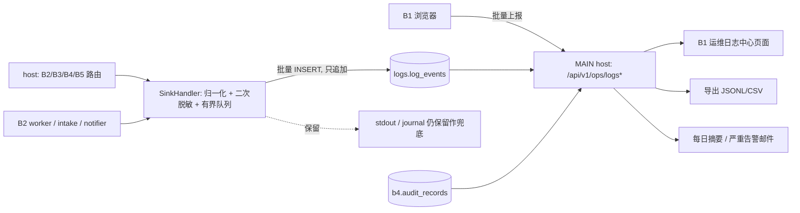

# 统一日志中心（RQ-B-1/2/3/4-99 的创新延伸）任务目标与实施计划

> 状态：待实施　|　来源：老师创新方向 + 仓库现状核查（2026-11-18）　|　配套提示词：[coding-prompt.md](./coding-prompt.md)

## 0. 一页结论

**老师的两个问题的回答：**
1. **能做统一入口。** 但要先补上一个现在不存在的东西：**统一的日志存储与查询**。
2. **怎么呈现：网页为主，导出下载为辅，邮件只做"摘要+告警"，不拿邮件当日志载体。**
   - 网页（管理员/教师）：检索、按请求串联各模块的链路、总览各模块健康、一键导出（对应各需求里"生成**并导出**日志"）。
   - 邮件：可选的每日摘要和严重故障告警（只含计数与链接，不含日志正文）。理由：邮件无法检索/关联、会泄露敏感内容、且服务器只有 1 vCPU / 512 MB / 10 GB。

**核查发现（均已在仓库验证）：**

| 事实 | 位置 | 含义 |
|---|---|---|
| B2/B3/B4 各有结构化 JSON 日志器，只写 **stdout**（systemd journal），各自一套字段名和脱敏规则 | `B2/.../logging/logger.py`、`B3/.../logging.py`、`B4/.../logging.py` | 格式不统一（B3 脱敏占位 `[redacted]`、B4 为 `[REDACTED]`；B2 单字段 200/整行 800 上限） |
| **B5 没有结构化日志**，只用标准 `logging.getLogger` | `B5/src/autograder_b5/api.py` | 需要补齐到统一格式 |
| **B1 的日志只进浏览器 console**，有 `setLogSink` 钩子但没人接 | `B1/src/logging/logger.ts` | 前端日志从未到达服务端 |
| **没有集中存储、没有查询 API、没有页面、没有导出**；唯一的查询接口是 B4 `GET /api/v1/audit-records` | `B4/src/autograder_b4/api/audit.py` | 这是业务审计（谁改了什么），不是运行日志；统一入口应同时覆盖两者 |
| 进程不止一个：host（uvicorn，装载各模块 router）、`autograder_b2.worker`、intake/notification 定时任务 | `MAIN/deploy/*.service` | 日志汇集必须覆盖 worker 与定时任务，不能只挂 host |
| 数据库按模块分 schema，最小权限角色隔离 | `MAIN/infra/postgres/init.sql` | 日志库需新 schema + 仅 INSERT 的写入角色，**生产不能靠重建库来加** |
| **资源硬约束**：1 vCPU / 512 MB / 10 GB，其中"日志与临时文件"预算 ≤ 0.25 GB | `MAIN/docs/architecture/resource-budget.md` | 不能上 ELK/Loki；必须有保留期+容量上限；写日志不能拖慢主流程 |
| 关联标识已有基础：B1 生成与 `X-Request-ID` 同源的 `request_id`；B2 有 `correlation_id/submission_id/evaluation_run_id`；事件信封带 `correlation_id` | 各模块 | 跨模块串联可行，但需核实 host 是否把同一 `request_id` 透传给所有模块 |

## 1. 目标形态

## 2. 设计决策

- **L1 归属**：MAIN 负责（契约、SDK、组装）。实现放在 `MAIN/host` 内置的 ops 路由与 sink，不新增业务模块，不改变各模块的数据所有权。
- **L2 统一信封**（新契约 `MAIN/contracts/schemas/log-record.schema.json`）：
  `timestamp`(UTC, ms)、`level`(info|warn|error，debug 不入库)、`event`、`producer`(B1..B5|MAIN)、`process`(host|worker|intake|notifier|browser)、`request_id`、`correlation_id`、可选 UUID 型主体（`course_id`/`assignment_id`/`submission_id`/`evaluation_run_id`/`question_version_id`/`actor_id`）、`stage`、`fields`（白名单 JSON，≤2 KB）、`truncated`。一律省略缺失字段，不伪造空串。
- **L3 汇集方式**：进程内 `SinkHandler`（`logging.Handler`）→ 有界内存队列 → 批量写库。
  - **绝不阻塞、绝不抛异常**；队列满则丢最旧并累计丢弃计数（计数本身可在总览看到）。
  - 对各模块已有的 JSON 行做**归一化**（映射字段名、统一脱敏占位），不要求各模块重写日志语句；B5 的标准 logging 也被同一 handler 接住并补齐字段。
  - host 启动时挂一次；worker/intake/notifier 入口各调用同一个 MAIN 提供的 `attach_log_sink(process=...)`。
  - 不采用"收集 journald"：跨进程时序不可靠、解析脆弱、受 `ProtectSystem/PrivateTmp` 沙箱限制、开发环境无 journald。
  - **不新增外部服务/生产依赖**（沿用 PostgreSQL）。
- **L4 存储与保留**：`logs.log_events`，只追加；索引 `occurred_at`、`(producer, level, occurred_at)`、`request_id`、`correlation_id`。保留策略**同时**按时间（默认 info 7 天、warn/error 30 天）和总容量（硬上限默认 128 MB，超出从最旧清理，error 最后清）。清理由现有定时机制执行，清理动作本身记一条日志。P0 先测真实日志量，据此定默认值，并把 `resource-budget.md` 的日志预算写实。
- **L5 访问控制**：管理员全量；教师只读**与其课程相关**的事件（带 `course_id` 且在其授权课程内，沿用 B4 审计接口的"过滤而非事后脱敏"做法）；学生无权限。**查看与导出本身要记审计**（`logs.viewed` / `logs.exported`）。
- **L6 脱敏纵深**：模块侧脱敏保留；入库前再做一遍**白名单**二次脱敏（源码、参考答案、隐藏用例/期望、fixture 内容、令牌、口令、邮箱/姓名/学号、连接串一律不入库）。入库字段名白名单，未知字段丢弃而不是原样存。
- **L7 统一入口 = 运维日志 + 业务审计 + 邮件记录**：页面里"审计记录"页签读取 B4 现有接口，"邮件记录"链接到现有复核页的邮件记录；不复制数据，只统一入口。
- **L8 与前一需求联动**：`io_type`（题目 IO 类型）出现在评测/题库相关日志的 `fields` 里，可作为检索条件。
- **L9 事件目录**：新增 `event-catalog.md`，列出每个模块必须产生的关键事件（RQ-B-x-99 的可验收清单）：
  - B1：登录成功/失败、路由与 API 错误、提交动作、前端异常
  - B2：提交接收、评测开始/结束/失败、沙箱不可用、依赖故障（已有命名事件）、邮件收件
  - B3：题目创建/发布/改版、编译/校验失败、参考答案验证、统计任务
  - B4：登录/刷新/拒绝、用户与课程变更、通知发送
  - B5：认证拒绝、报告生成
  - MAIN：启动/就绪、日志清理、导出、丢弃计数

## 3. 页面与交互（B1，管理员/教师可见入口）

新增导航项 **「运维日志」** → `/ops/logs`，用现有 `auth/guards.tsx`、`visibility.ts` 控制可见，文案走 i18n（zh-CN）。

| 页签 | 内容 |
|---|---|
| 总览 | 每个模块一张卡：最近日志时间、近 1h/24h 的 warn/error 数、`/health/ready` 状态；"X 分钟无日志"醒目标红；丢弃计数 |
| 日志检索 | 时间范围、模块、级别、事件名、`request_id`/`correlation_id`/`submission_id` 精确查询、关键词；游标分页；点行开抽屉看格式化 JSON（带"已脱敏"标注） |
| 链路追踪 | 输入或点选一个 `request_id`/`correlation_id`，按时间线跨模块展示（B1→B3→B2→B4…），失败节点高亮 |
| 审计记录 | 复用 B4 `audit-records` |
| 导出 | 当前筛选条件导出 JSONL/CSV；行数/体积有上限；导出文件头标注时间范围与条件；导出动作记审计 |

**入口深链（高价值）**：在提交详情/评分证据（`grades/CaseEvidence`）、申诉、复核页加"查看相关日志"，带 `correlation_id`/`submission_id` 跳到链路追踪，教师排查一条失败提交不必会查日志。

## 4. 邮件（可选，放在最后一期）

- **每日摘要**：各模块 error/warn 计数、Top 事件、丢弃计数、异常模块；发给管理员，含页面链接，**不含日志正文**。
- **严重告警**：`sandbox/database/broker unavailable` 等依赖故障事件、某模块持续无日志、错误率陡增；带节流与去重（同类 30 分钟内最多一封）。
- 复用现有 SMTP 通道（B4 `notifications.py` / B2 `receipt_mailer.py`），不引入新服务；开关与收件人由管理员配置。

## 5. 影响面清单

1. **MAIN 契约**：`log-record.schema.json`；新增 ops 日志 OpenAPI（建议 `MAIN/contracts/openapi/ops.yaml`，需更新契约清单/锁摘要与 CHANGELOG）；`event-catalog.md`。
2. **MAIN host**：`SinkHandler`、归一化与二次脱敏、`logs` schema 迁移、写入/只读角色、查询/追踪/总览/导出 API、清理任务；`init.sql` 与部署脚本（`initialize-db.sh`、`runtime.env` 生成）新增角色与 DSN，**走非破坏性迁移**。
3. **B2**：worker/intake/notifier 入口挂 sink；字段上限与新信封对齐；关键事件补齐。
4. **B3 / B4**：脱敏占位与字段名对齐信封；关键事件补齐；B4 审计接口权限模型作为教师范围过滤的参照。
5. **B5**：从标准 logging 升级为结构化日志并挂 sink；补关键事件。
6. **B1**：运维日志页面、导航与权限、深链入口、前端日志上报（接 `setLogSink` → 批量 POST，失败静默、有界缓冲）、i18n、生成类型。
7. **关联标识贯通**：核实并保证 host 中间件对所有模块透传同一 `request_id`；跨模块调用与事件携带 `correlation_id`；字段命名统一为 `request_id`（HTTP 一次请求）与 `correlation_id`（跨进程业务链）。
8. **安全**：访问控制、查看/导出审计、二次脱敏白名单、导出上限、B1 上报端点限流与体积上限、防日志注入（控制字符转义）、不引入学生个人信息。
9. **资源**：写入批量化、查询必须走索引并带时间范围上限、导出流式、容量上限与清理；更新 `resource-budget.md`。
10. **运维**：兜底仍保留 stdout/journal；日志库不可用时主业务不受影响（降级为只写 stdout，并在总览可见）。

## 6. 任务目标与验收

| 编号 | 目标 | 线上验收 |
|---|---|---|
| H1 | 五个板块（B1–B5）+ MAIN 的运行日志进入同一存储，格式统一 | 总览页五个模块都有最近日志时间 |
| H2 | 提供检索与跨模块链路追踪 | 对一次真实提交，用其 `correlation_id` 看到 B1→评测→回写的时间线 |
| H3 | 导出日志（JSONL/CSV），有上限与审计 | 管理员导出得到文件，审计记录里有该导出 |
| H4 | 权限正确：管理员全量、教师仅本课程、学生拒绝 | 三类账号访问结果符合预期（学生 403） |
| H5 | 敏感数据不入库 | 自动化测试：含源码/答案/口令/邮箱的日志入库后均被脱敏或丢弃 |
| H6 | 不拖累主流程；日志库故障可降级 | 测试：写库失败/队列满时业务请求仍成功，丢弃计数增加 |
| H7 | 容量受控 | 超过容量上限后自动清理最旧记录，清理有日志 |
| H8 | 页面入口与深链可用 | 评分证据页"查看相关日志"可跳转并定位 |
| H9 | （可选）摘要/告警邮件 | 触发一次依赖故障事件，管理员收到去重后的告警邮件 |

## 7. 分阶段计划（每期独立提交并线上验证）

| 阶段 | 内容 | 完成定义 |
|---|---|---|
| **Q0 核查（只读）** | 统计各模块当前真实日志量与已有事件清单；验证 `request_id` 是否透传；确认 B5 现状；确认非破坏性加 schema/角色的生产路径；结论写入本文第 9 节 | 结论落文档；默认保留期/容量据此确定 |
| **Q1 契约** | `log-record` schema、ops OpenAPI、`event-catalog.md`、锁摘要、CHANGELOG | 契约检查通过 |
| **Q2 汇集** | `SinkHandler`+归一化+二次脱敏+有界队列；`logs` schema 与角色（非破坏性迁移）；host 与 worker/intake/notifier 接入；B5 结构化；各模块字段/占位对齐 | 单测覆盖脱敏、丢弃、降级；线上有数据落库 |
| **Q3 查询与导出 API** | 检索/追踪/总览/导出/清理；权限与审计；容量保护 | API 测试通过（含三类角色） |
| **Q4 B1 页面** | 导航、四页签、抽屉、导出；深链入口；前端日志上报；生成类型 | Vitest/类型检查/lint 通过 |
| **Q5 事件补齐** | 按事件目录补齐 B1–B5/MAIN 关键事件，补验收测试 | 目录中每个事件有测试或线上证据 |
| **Q6 邮件摘要与告警（可选）** | 摘要、告警、节流、开关 | 线上收到去重告警 |
| **Q7 线上验收** | 推送→Actions 全绿→用 `admin`/`testuser` 按 H1–H9 验证，报告真实结果与未验证项 | 报告 |

依赖：Q0 → Q1 → Q2 → Q3 → (Q4 ∥ Q5) → Q6 → Q7。

## 8. 风险与待确认

| # | 问题 | 默认处理 |
|---|---|---|
| R1 | 教师可看日志（**已确认**）；范围待定 | 只读，仅限其授权课程范围内的事件；全平台级事件（启动、清理、依赖故障等）仅管理员可见 |
| R2 | 生产加 schema/角色不能重建库 | 走幂等的非破坏性迁移，先在 Q0 确认路径 |
| R3 | 日志量超预期撑爆预算 | 容量硬上限+按级别保留+info 采样/聚合（Q0 数据决定） |
| R4 | 日志里夹带敏感内容 | 入库白名单 + 自动化泄露测试（H5） |
| R5 | 邮件告警风暴 | 节流+去重+开关，且放最后一期 |
| R6 | 日常规则：禁止本地构建，线上验收 | 只跑受影响静态检查/测试，推送后跟进 Actions |

## 9. Q0 核查结论（由 CODING AI 填写）

- **核查时间**：2026-11-18
- **1. 各模块日志现状与日志量估算**：
  - **B1**（`B1/src/logging/logger.ts`）：仅写浏览器 `console.*`；`setLogSink` 仅支持 `VITE_LOG_ENDPOINT`（未配置时落 200 条有界内存缓冲），无服务端上报端点。`main.tsx`、`api/client.ts`、`auth/sessionStore.ts`、`app/ErrorBoundary.tsx` 及各 feature hooks 已有结构化 `log()` 调用。
  - **B2**（`B2/src/autograder_b2/logging/`）：结构化 JSON 行写 stdout；~20 个源文件约 60+ 处日志调用；`MAX_LOG_FIELD=200`、`MAX_LOG_LINE=800`，占位符为 `<redacted-path>` / `<redacted-credential>` / `<redacted-host>`；已有依赖故障命名事件（`runner.sandbox_unavailable`、`persistence.database_unavailable`、`messaging.broker_unavailable`）。
  - **B3**（`B3/src/autograder_b3/logging.py`）：结构化 JSON 行写 stdout；~16 个源文件约 65 处 `log_event`/`logger.*` 调用；`MAX_STRING_CHARS=512`，脱敏占位为 `[redacted]`（小写）。
  - **B4**（`B4/src/autograder_b4/logging.py`）：结构化 JSON 行写 stdout；~16 个源文件约 40 处日志调用；脱敏占位为 `[REDACTED]`（大写）；另有 `b4.audit_records` 业务审计表与 `GET /api/v1/audit-records`。
  - **B5**（`B5/src/autograder_b5/api.py`）：仅使用标准 `logging.getLogger("autograder_b5")`，当前仅 1 处 `logger.warning("conformance.request.unauthenticated", ...)`，无结构化 JSON formatter。
  - **MAIN**（`MAIN/host/src/autograder_host/main.py`）：当前无结构化日志与自身运行日志。
  - **日志量与容量默认值依据**：按单课程日常负载（约 2,000–10,000 条/天，归一化后每条约 400–700 B，含行开销与索引约 1 KB/行，即 2–10 MB/天），7 天 info 约 14–70 MB，30 天 warn/error（<5%）约 <5 MB，总计远低于 `resource-budget.md` 中 "日志与临时文件 ≤ 0.25 GB (256 MB)" 的预算。据此确定默认值：**保留期 info 7 天、warn/error 30 天；PostgreSQL `logs` schema 容量硬上限 128 MB**（留 ≥128 MB 给沙箱临时工作区与 stdout journal）。
- **2. `request_id` 透传与 `correlation_id` 核查**：
  - B1（`B1/src/api/client.ts`）已为每次请求生成 UUID v4 `X-Request-ID`。
  - `MAIN/host/src/autograder_host/main.py` 的 CORS 配置允许并暴露 `x-request-id`，但 **host 自身尚无请求级 `request_id` 中间件**；若调用方未传 `X-Request-ID`，B2/B3/B4 会各自生成不同 UUID。需在 `MAIN/host` 增加统一请求上下文中间件（读取/校验或生成 UUID v4 `X-Request-ID`，同步写入 ASGI 请求头、响应头与 host 级 `ContextVar`）。
  - 事件信封（B2 `domain/envelope.py`、B3 `events/envelope.py`、B4 `messaging/envelope.py`）均已携带 UUID 型 `correlation_id`。
- **3. 生产非破坏性加 schema / 角色路径**：
  - `MAIN/deploy/deploy-release.sh` 在每次部署时 source `/etc/autograder/setup.env`（含超级用户 `PLATFORM_DATABASE_URL`）与 `/etc/autograder/runtime.env`，并以 `autograder` 用户执行 `MAIN/scripts/production-prepare.sh`。
  - 四个 systemd unit（`autograder.service`、`autograder-worker.service`、`autograder-intake.service`、`autograder-notifications.service`）均配置了 `ReadWritePaths=/var/lib/autograder`。
  - 路径：更新 `MAIN/infra/postgres/init.sql` 覆盖全新初始化；同时在 `MAIN/host` 提供幂等 `python -m autograder_host.logs.provision`（由 `production-prepare.sh` 使用 `PLATFORM_DATABASE_URL` 调用），幂等创建 `logs` schema、表/索引及最小权限角色（`autograder_logs_writer` 仅 `INSERT`、`autograder_logs_reader` 仅 `SELECT`、`autograder_logs_ops` 负责清理 `DELETE` 与状态表），并在未显式配置 `LOGS_*_DATABASE_URL` 时将运行时 DSN 写入 `/var/lib/autograder/logs/db.env`（0600），供四个服务进程自动读取，无需重建生产库。

